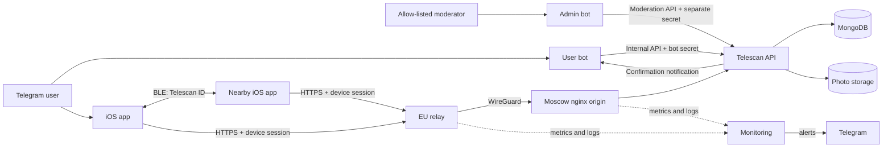

# Telescan System Architecture

**Last reviewed: August 27, 2026.**

## Product boundary

Telescan is an iOS Telegram extension for discovering nearby Telescan users over
Bluetooth Low Energy and opening the public Telegram profile each user has chosen
to share. BLE performs local discovery; the backend owns identity, sessions,
profiles, photos, reports, and blocks.

The system does not read Telegram messages or contacts and does not send GPS,
BLE signal strength, estimated distance, or the device-local encounter history
to the backend.

## Components

- **iOS client:** advertises and scans a compact stable Telescan identifier,
  resolves complete profiles through the authenticated API, caches the current
  account and block list, and owns nearby-distance presentation and the local
  24-hour **Met** encounter history.
- **User bot:** reads the user's current public Telegram profile, asks the API to
  issue a one-time link code, and delivers server-side confirmation messages.
- **Admin bot:** exposes report queues to an explicit Telegram ID allow-list and
  talks only to the moderation API.
- **API:** owns every application collection, the optional 36-character BIO,
  and all profile-photo operations.
- **MongoDB:** stores users, normal and App Review link codes, sessions,
  confirmation requests, reports, blocks, and shared rate-limit counters.
- **Photo storage:** stores API-owned profile-photo objects.
- **Moscow nginx:** serves the main domain, enforces the public route policy, and
  exposes a WireGuard-only API origin.
- **EU relay:** terminates public API TLS in the Netherlands and forwards to the
  Moscow origin through WireGuard.
- **Monitoring:** collects cross-host metrics and logs over a separate
  WireGuard network, evaluates alerts, and delivers them through Telegram.

## Account linking and sessions

1. iOS authenticates the primary Telescan account with Sign in with Apple.
   The API verifies the identity-token signature, issuer, audience, expiry, and
   nonce, then returns the device access and refresh tokens.
2. The user requests a code from the Telegram bot.
3. The bot submits the current Telegram ID, name, username, and explicit photo
   state to the internal API.
4. The API creates or updates the pending Telegram profile and issues a random
   eight-character code. Only an HMAC-SHA-256 digest is stored.
5. iOS submits the clear code to the authenticated Telegram-link endpoint.
6. The API atomically consumes the code, attaches the Telegram identity to the
   Apple-authenticated account, and returns the shared profile plus a replacement
   access JWT for the same device session. The existing refresh token remains
   valid; a Telegram code can never create a session by itself.

The refresh token is stored only as a SHA-256 digest server-side and rotates on
every refresh. Reuse revokes the affected device session. Every protected
request validates the JWT, active session, and attached Apple identity, so a
legacy Telegram-only session cannot authorize the client. The rollout migration
revokes such legacy sessions without deleting their profiles; the first Apple
sign-in and Telegram link adopts the existing profile and public Telescan ID.
Current-device logout and account deletion take effect immediately.

The server retains the older logout-all confirmation contract, but the current
iOS MVP exposes current-device logout and account deletion only. Do not expose
remote logout again until reliable client delivery is available.

## BLE discovery contract

BLE advertisements expose only the fixed Telescan service UUID. The stable
random `telescan_id` is read as 16 lossless bytes from the compact identity
characteristic; the compatibility characteristic also exposes lowercase UUID
text for staged upgrades. Neither the short-lived Telegram link code nor the
username is advertised. The scanner resolves the identifier through
`GET /api/v1/profiles/{telescan_id}`.

A nearby candidate is presented only after the API returns a matching accessible
profile with a usable Telegram username and optional BIO. Incomplete responses
must never produce an `Unknown` row. Signal strength and approximate distance
are local hints only. Rows retain discovery order, while displayed distance is
recalculated every 10 seconds from local RSSI samples.

A resolved nearby profile starts a persistent 60-second heartbeat buffer that
is refreshed by every BLE signal and checkpointed to device storage at bounded
intervals. During signal silence the UI shows the remaining expiry time. When
the buffer expires, iOS removes the profile from **Nearby**, upserts it into
**Met** using the last real signal timestamp, and clears that pending entry. If
iOS terminates the process first, the remaining buffer entries are moved into
**Met** on the next launch before BLE scanning restarts. Network failure
suppresses unresolved profiles and must not increment the nearby badge.

The profile snapshot and last-seen timestamp remain in `UserDefaults` for up to
24 hours and are never uploaded. A later nearby discovery does not remove the
existing history entry; the last-seen value is replaced after the next confirmed
heartbeat expiry. Blocking removes the entry; manual clearing, sign-out, and
account deletion clear the local history.

## Reports and blocks

`POST /api/v1/reports` accepts an idempotency UUID, target Telescan ID, reason,
and optional context. The API captures the target name, username, BIO, and photo
snapshot and stores the
moderation lifecycle independently of the live profile.

Blocking is enforced server-side in both profile-lookup directions. iOS removes
the target after the API confirms the block and caches block IDs so a blocked
profile remains suppressed during a network outage. Users can list and remove
their blocks from the app.

The admin bot uses a separate moderation credential, has no MongoDB or photo
storage credentials, and records the acting moderator Telegram ID with each
decision.

## API authorization surface

| Surface | Examples | Authorization |
| --- | --- | --- |
| Public bootstrap/legal | `/privacy`, `/terms`, `/api/v1/auth/apple`, `/api/v1/auth/refresh` | Public document, Apple identity token, or refresh token |
| iOS account/session | `/api/v1/auth/session`, `/api/v1/users/me`, `/api/v1/users/me/telegram/link` | Active access JWT and device session |
| Nearby/moderation actions | `/api/v1/profiles/...`, `/api/v1/reports`, `/api/v1/users/me/blocks...` | Active access JWT and device session |
| User-bot service | `/internal/v1/link-codes`, confirmation routes | `BOT_SERVICE_SECRET` |
| Admin moderation | `/internal/v1/moderation/reports...` | `MODERATION_SERVICE_SECRET` |

Legacy `/v1` routes exist only behind `ENABLE_LEGACY_API` and are hidden from
OpenAPI. Remove them and legacy code hashes after supported-client adoption.

## Data ownership and deletion

The API is the only service that reads or writes MongoDB and photo storage.
Application clients never receive database or object-storage credentials.

Account deletion revokes sessions first, then removes the Apple identity,
photos, link codes,
confirmation requests, blocks, device sessions, and the user record. Abuse
reports remain for the limited moderation period with direct account relations
removed. Resolved or dismissed reports expire through a 180-day TTL.

The device-local encounter history is outside the API data model and is cleared
by the iOS client during sign-out and account deletion.

## Public network boundary

Both the EU edge and Moscow edge return `404` for `/internal/`, `/docs`,
`/docs/`, `/redoc`, and `/openapi.json`. FastAPI OpenAPI remains enabled and is
reachable only through the API loopback port and an administrative SSH tunnel.

The API and MongoDB ports are published only on the Moscow loopback interface.
The WireGuard origin listener is restricted to the EU peer and must never bind
to a public interface.

Prometheus and Loki ingest only through the dedicated `wg-monitor` network.
Grafana is available through an administrator SSH tunnel. Telegram alert
delivery uses a domain-restricted proxy on the EU host; it is not a general
public egress service.
