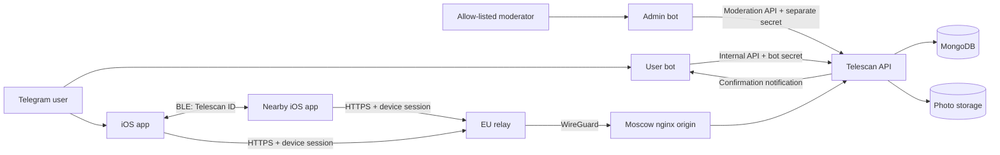

# Telescan System Architecture

**Last reviewed: August 17, 2026.**

## Product boundary

Telescan is an iOS Telegram extension for discovering nearby Telescan users over
Bluetooth Low Energy and opening the public Telegram profile each user has chosen
to share. BLE performs local discovery; the backend owns identity, sessions,
profiles, photos, reports, and blocks.

The system does not read Telegram messages or contacts and does not send GPS,
BLE signal strength, estimated distance, or movement history to the backend.

## Components

- **iOS client:** advertises and scans a compact stable Telescan identifier,
  resolves complete profiles through the authenticated API, caches the current
  account and block list, and owns all nearby-distance presentation.
- **User bot:** reads the user's current public Telegram profile, asks the API to
  issue a one-time link code, and delivers server-side confirmation messages.
- **Admin bot:** exposes report queues to an explicit Telegram ID allow-list and
  talks only to the moderation API.
- **API:** owns every application collection and all profile-photo operations.
- **MongoDB:** stores users, link codes, sessions, confirmation requests,
  reports, and blocks.
- **Photo storage:** stores API-owned profile-photo objects.
- **Moscow nginx:** serves the main domain, enforces the public route policy, and
  exposes a WireGuard-only API origin.
- **EU relay:** terminates public API TLS in the Netherlands and forwards to the
  Moscow origin through WireGuard.

## Account linking and sessions

1. The user requests a code from the Telegram bot.
2. The bot submits the current Telegram ID, name, username, and explicit photo
   state to the internal API.
3. The API creates or updates the account and issues a random eight-character
   code. Only an HMAC-SHA-256 digest is stored in the normal model.
4. iOS submits the clear code with a random installation `device_id`.
5. The API atomically consumes the code and returns a short-lived access JWT, a
   rotating refresh token, the random public `telescan_id`, and the shared
   profile.

The refresh token is stored only as a SHA-256 digest server-side and rotates on
every refresh. Reuse revokes the affected device session. Every protected
request validates both the JWT and the active session, so current-device logout
and account deletion take effect immediately.

The server retains the older logout-all confirmation contract, but the current
iOS MVP exposes current-device logout and account deletion only. Do not expose
remote logout again until reliable client delivery is available.

## BLE discovery contract

BLE advertisements carry the stable random `telescan_id`, not the short-lived
Telegram link code and not a username. The value fits the effective local-name
payload used by CoreBluetooth. The scanner parses the compact identifier and
resolves it through `GET /api/v1/profiles/{telescan_id}`.

A nearby candidate is presented only after the API returns a matching accessible
profile with a usable Telegram username. Incomplete responses must never produce
an `Unknown` row. Signal strength and approximate distance are local hints only.

The nearby list retains a profile briefly after signal loss to absorb BLE gaps.
The UI shows the remaining expiry time. Network failure suppresses unresolved
profiles and must not increment the nearby badge.

## Reports and blocks

`POST /api/v1/reports` accepts an idempotency UUID, target Telescan ID, reason,
and optional context. The API captures a target profile snapshot and stores the
moderation lifecycle independently of the live profile.

Blocking is enforced server-side in both profile-lookup directions. iOS removes
the target after the API confirms the block and caches block IDs so a blocked
profile remains suppressed during a network outage. Users can list and remove
their blocks from the app.

The admin bot uses a separate moderation credential, has no MongoDB or photo
storage credentials, and records the acting moderator Telegram ID with each
decision.

## API authorization surface

| Surface | Examples | Authorization |
| --- | --- | --- |
| Public bootstrap/legal | `/privacy`, `/terms`, `/api/v1/auth/link`, `/api/v1/auth/refresh` | Public document, one-time code, or refresh token |
| iOS account/session | `/api/v1/auth/session`, `/api/v1/users/me` | Active access JWT and device session |
| Nearby/moderation actions | `/api/v1/profiles/...`, `/api/v1/reports`, `/api/v1/users/me/blocks...` | Active access JWT and device session |
| User-bot service | `/internal/v1/link-codes`, confirmation routes | `BOT_SERVICE_SECRET` |
| Admin moderation | `/internal/v1/moderation/reports...` | `MODERATION_SERVICE_SECRET` |

Legacy `/v1` routes exist only behind `ENABLE_LEGACY_API` and are hidden from
OpenAPI. Remove them and legacy code hashes after supported-client adoption.

## Data ownership and deletion

The API is the only service that reads or writes MongoDB and photo storage.
Application clients never receive database or object-storage credentials.

Account deletion revokes sessions first, then removes photos, link codes,
confirmation requests, blocks, device sessions, and the user record. Abuse
reports remain for the limited moderation period with direct account relations
removed. Resolved or dismissed reports expire through a 180-day TTL.

## Public network boundary

Both the EU edge and Moscow edge return `404` for `/internal/`, `/docs`,
`/docs/`, `/redoc`, and `/openapi.json`. FastAPI OpenAPI remains enabled and is
reachable only through the API loopback port and an administrative SSH tunnel.

The API and MongoDB ports are published only on the Moscow loopback interface.
The WireGuard origin listener is restricted to the EU peer and must never bind
to a public interface.
